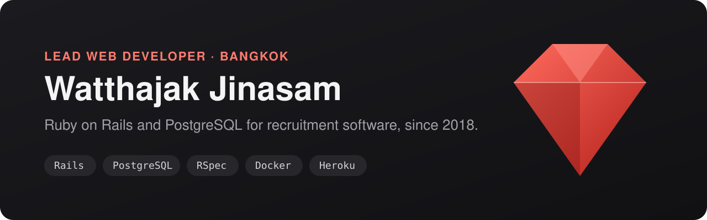

### Hi, I'm Watthajak Jinasam 👋

Lead Web Developer at **Reeracoen Tech** in Bangkok since 2018. This is my work account: Ruby on Rails and
PostgreSQL for recruitment software. Almost everything I write here lives in private company repositories, so most
of the green squares are private.

**Profile / resume:** [watthajak2018.github.io/profile](https://watthajak2018.github.io/profile/)

#### What I work on (private)

| Area | What it means day to day |
|---|---|
| Applicant tracking system | An in-house Rails app for companies, jobs, candidates and the selection process |
| Public sites | A job board and an HR Q&A site: sign-in, job search, blogs, landing pages, notifications |
| Recruitment dashboards | Hiring funnel, time-to-hire and similar reports, kept correct under division-level permissions |
| SQL performance | Reading the SQL ActiveRecord generates, then reworking it with CTEs, indexes and split queries |
| Integrations | Ruby API clients for recruitment CRMs, webhooks, scheduled sync jobs |

I write the system design and database design for new features, split the work into tickets with estimates, and keep
every change behind RSpec and linters on CI.

#### Gists

| Gist | What it is |
|---|---|
| [brew commands](https://gist.github.com/watthajak2018/207412388b6b22e733f8e94c663c7b60) | Update and clean Homebrew |
| [Git commands](https://gist.github.com/watthajak2018/992ca0aaecaa8bbda3f37d9ed060c267) | Clean the reflog, prune objects, check repo size |

#### Stack

Ruby · Ruby on Rails · PostgreSQL · Redis · Elasticsearch · RSpec · RuboCop · Slim · SCSS · Docker · Heroku ·
CircleCI · GitHub Actions · Scout APM · Bugsnag · Claude Code
